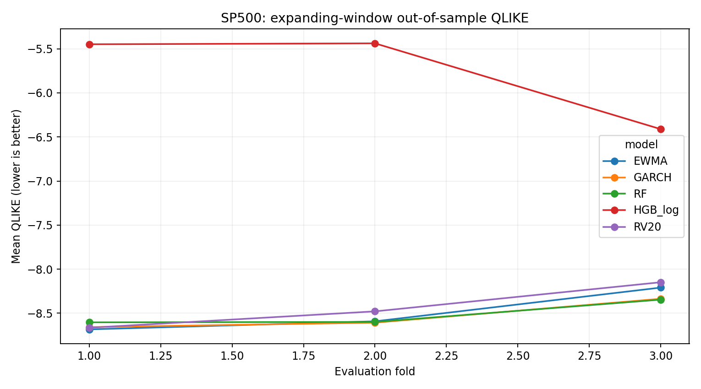
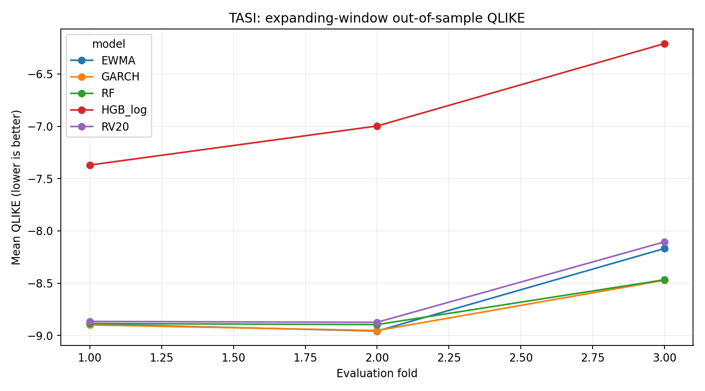

# Cross-Market Volatility Forecasting

### S&P 500 vs. Saudi TASI | Statistical Modeling & Machine Learning

A reproducible financial data science portfolio project comparing **one-trading-session-ahead squared log-return forecasts** for the S&P 500 (United States) and TASI (Saudi Arabia). The project evaluates statistical volatility estimators alongside machine-learning models using chronological out-of-sample testing.

> **Scope:** This is a methodological forecasting comparison—not a trading strategy, a forecast of directly observed latent volatility, or evidence that any model is universally superior.

## Project at a glance

| Component | Description |
|---|---|
| Markets | S&P 500 (US) and TASI (Saudi Arabia) |
| Forecast target | Next-session squared log return (a noisy volatility proxy) |
| Statistical models | 20-session rolling variance (RV20), EWMA, Gaussian GARCH(1,1) |
| Machine learning | Random Forest, histogram gradient boosting |
| Evaluation | Three chronological expanding-window folds per market |
| Metrics | QLIKE (primary; lower is better) and mean squared error (MSE) |
| Additional analyses | Moving-block bootstrap contrasts with Holm correction, sensitivity checks, descriptive cross-market transfer |
| Tools | Python, pandas, NumPy, SciPy, scikit-learn, pytest; external `arch` check |

## Out-of-sample results

The following table reports the **lowest QLIKE within each market and evaluation fold**, selected descriptively from the models evaluated. **Lower QLIKE is better.** These comparisons do not establish statistical significance or general superiority.

| Market | Fold | Best model | QLIKE |
|---|---:|---|---:|
| S&P 500 | 1 | EWMA | -8.6829 |
| S&P 500 | 2 | GARCH(1,1) | -8.6069 |
| S&P 500 | 3 | Random Forest | -8.3458 |
| Saudi TASI | 1 | GARCH(1,1) | -8.8989 |
| Saudi TASI | 2 | EWMA | -8.9573 |
| Saudi TASI | 3 | GARCH(1,1) | -8.4717 |

Full model-by-model scores and MSE values: [`results_final/fold_scores.csv`](results_final/fold_scores.csv).

### S&P 500: QLIKE by evaluation fold



### Saudi TASI: QLIKE by evaluation fold



> Scores from different markets or evaluation folds should not be interpreted as direct comparisons of market predictability. The underlying return distributions and test windows differ.

## Key findings

- **Model rankings depend on the market and test period.** EWMA, GARCH, and Random Forest each lead in at least one fold; no model dominates every evaluation.
- **Simple statistical benchmarks remain competitive.** Additional machine-learning complexity does not guarantee better out-of-sample QLIKE.
- **Cross-market transfer is exploratory.** Training on one market and evaluating on another is a descriptive robustness exercise, not evidence of causal information transfer. See [`results_final/aligned_transfer.csv`](results_final/aligned_transfer.csv).
- **Most pairwise differences remain uncertain.** All 60 within-fold QLIKE contrasts are now reported with circular moving-block bootstrap intervals and project-wide Holm-adjusted p-values. After correction, `HGB_log` has higher QLIKE than several alternatives in S&P 500 folds 1–2 and TASI fold 1; most other pairwise differences are inconclusive. Intervals remain pointwise and exploratory, and only three test windows are available. See [`results_final/pairwise_qlike_comparisons.csv`](results_final/pairwise_qlike_comparisons.csv). The earlier RF-vs-EWMA intervals remain as an unadjusted descriptive analysis.

## Model validation and audit

Automated tests address GARCH recursion, temporal boundary handling, prevention of future-target leakage, and other implementation checks. The project owner also executed an **external GARCH parameter-estimation comparison using Python's `arch` library in Google Colab**; both external optimizations reported convergence.

The external comparison supports the numerical plausibility of the implementation, **but does not establish exact equivalence** of parameter estimates, conditional variance paths, one-step forecasts, or native likelihood conventions.

- [External validation notes](EXTERNAL_VALIDATION.md)
- [Recorded external comparison results](EXTERNAL_ARCH_RESULTS.csv)
- [Validation status and scope](VALIDATION_STATUS.md)
- [Technical report and limitations](TECHNICAL_REPORT.md)

## Repository structure

```text
.
├── README.md
├── requirements.txt
├── src/                       # Data preparation, modeling, validation
├── tests/                     # Automated tests
├── results_final/             # Model scores, predictions, figures
├── TECHNICAL_REPORT.md        # Methods, results, limitations
├── EXTERNAL_VALIDATION.md     # Third-party GARCH estimation check
├── EXTERNAL_ARCH_RESULTS.csv  # Recorded comparison results
└── VALIDATION_STATUS.md       # Validation scope and status
```

## Run in Google Colab

Open [Volatility_Forecasting_Colab.ipynb](Volatility_Forecasting_Colab.ipynb) in Colab. It clones the public repository, reads price CSVs from Drive, runs the tests and analysis, and downloads a results archive.

## Reproduce the analysis

Use **Python 3.10+** and run the following from the repository root:

```bash
python -m pip install -r requirements.txt
python -m pytest -q tests
python src/portfolio_v7.py --data-dir data --output-dir results_final
```

### Data requirements

The analysis expects two CSV files:

- `data/sp500.csv`
- `data/tasi.csv`

Each file must contain **`Date`** and **`Close`** columns; the analysis sorts dates internally. Raw market price data are **not included in this public repository** because redistribution rights have not been established. Exact numerical reproduction requires matching source prices and compatible dependency versions. Each run writes `run_metadata.json` with input row counts, SHA-256 hashes, fold settings, and installed package versions so the local inputs and environment can be identified. It also writes `pairwise_qlike_comparisons.csv`, comparing every model pair on identical dates and correcting p-values across markets and folds with Holm's method. The percentile intervals are pointwise, not simultaneous. The public repository therefore contains code, tests, and recorded outputs, but is **not fully self-contained for exact reproduction**.

To run the optional third-party GARCH estimator check in an environment with network access:

```bash
python -m pip install arch
python src/verify_with_arch.py
```

## Limitations

- Squared daily log returns are noisy proxies for unobserved conditional volatility.
- Market holidays, different trading calendars, and market structures complicate cross-market interpretation.
- Model selection and sensitivity analyses are exploratory; the separate RF-vs-EWMA bootstrap intervals are not multiplicity-adjusted. The all-pairs comparison uses project-wide Holm-adjusted p-values, while its confidence intervals remain pointwise.
- These historical results are **not investment advice** or evidence of out-of-sample trading profitability.
- The external `arch` comparison confirms successful independent optimizer execution, **not identical one-step forecasts**.

For detailed methods and caveats, read the [technical report](TECHNICAL_REPORT.md).
